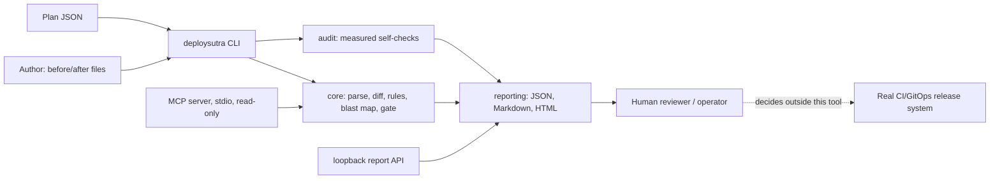

# DeploySutra AI - Architecture v0.2

## C4 level 1 - system context
Engineers hand DeploySutra **local, explicit** desired-state files (Kubernetes YAML/JSON) or an exported infrastructure-plan JSON. It reads only those files, computes static policy and change evidence, writes review reports, and stops. Deployment belongs to an independent human operator and an established CI/GitOps controller. DeploySutra never talks to a cluster, cloud or model.

## C4 level 2 - containers
| Container | Path | Responsibility |
|---|---|---|
| CLI | `packages/cli/index.mjs` | Offline commands: `analyze`, `policy`, `rules`, `explain`, `tofu`, `verify`, `audit`, `doctor`, `install-skills`, `serve`, `mcp`. No deploy/apply subcommand exists. |
| Core | `packages/core/*.mjs` | Deterministic analysis, importable without network or model. |
| Reporting | `packages/reporting/index.mjs` | JSON, Markdown, self-contained accessible HTML; refuses unsealed or tampered input. |
| Loopback server | `packages/server/index.mjs` | Bearer-token, 127.0.0.1 only, GET only, serves one preloaded verified report. |
| MCP server | `packages/server/mcp.mjs` | Six read-only tools over stdio, one workspace root, relative paths only. |
| Skill layer | `skills/`, `agents/`, `.claude/agents/` | 25 portable skills and 20 role files generated from one table (`scripts/generate-skills.mjs`). |
| Planned adapters | n/a | OPA/Conftest, Helm/Kustomize, live read-only drift, signed provenance. Not implemented. |

## C4 level 3 - core components
| Module | Role |
|---|---|
| `util.mjs` | SHA-256, deterministic `canonical()` JSON, `seal`/`verify`, `safeFile` (regular file, no symlink, <= 1 MiB), `clean`. |
| `yaml.mjs` | Strict YAML subset with exact source maps and multi-document streams. Rejects what it cannot read. |
| `manifest.mjs` | `readManifests`, JSON line maps, semantic diff with redaction, blast-radius questions. |
| `rules.mjs` | Rule registry (19 stable IDs, trigger, why, remediation, false-positive note), profiles, `checkPolicies`. |
| `blast.mjs` | BlastMap edges from supplied manifests; unsupplied targets are `UNKNOWN`. |
| `assess.mjs` | Two-snapshot comparison, new vs persistent findings, gate and reasons, rollback evidence model, plan summary. |
| `corpus.mjs` | 50 labelled rule cases (regression corpus, not an independent benchmark). |
| `audit.mjs` | Independent self-audit (runs only from the CLI/proof; kept out of `index.mjs` so the core has no subprocess API). |

Data flow: `safeFile` -> `parseYAMLDocuments`/JSON -> identity reconciliation -> `diffManifests` + `checkPolicies` (before and after) -> new/persistent classification -> profile gate -> `seal` -> `saveReports`.

## Contracts
- `assess(before, after, rollbackEvidence?, {profile?})` accepts a single document or arrays from `readManifests` and returns a sealed `OFFLINE_STATIC_K8S` report. The gate is `BLOCKED` or `HUMAN_REVIEW_REQUIRED`; there is no `READY`.
- `inspectTofuPlan(json)` returns a sealed `IMPORTED_TOFU_PLAN_ACTIONS_ONLY` report: counts per action and resource type only.
- `runAudit({skipTests})` returns a sealed `SELF_AUDIT` report. Schema: `schemas/report.schema.json`.
- Equal inputs give identical analysis reports and digests (no timestamps in analysis reports; the audit report records `generatedAt` by design).

## Gate logic
A finding blocks when its severity is in the profile's `blockOn` (development and staging: HIGH; production: HIGH and MEDIUM), whether it is **new** or **persistent**. Missing rollback prerequisites always block. Tofu plans block when a destructive change hits a data-bearing resource type (name heuristic). Nothing can make the gate say ready.

## Security architecture
Inputs are untrusted data. No script evaluation, no subprocess in the core, no network, no credentials. Secret-like values are redacted or discarded before they reach any structure that is serialised. Output text is escaped per format. See `docs/THREAT_MODEL.md`.

## State machine
`DRAFT_INPUT` -> `PARSED` -> `STATIC_CHECKED` -> `BLOCKED` or `HUMAN_REVIEW_REQUIRED`. An operator approval, if it ever exists, must be recorded by a separate, access-controlled release controller. This CLI never emits it.

## Platform matrix
Developed and run on Windows 11 / Node 24. CI covers Ubuntu, Windows and macOS on Node 20, 22 and 24 (see the badge and the Actions tab for the actual result of each run). Native skill activation in every IDE, MCP Inspector, live clusters and Helm/OpenTofu binaries are **not** exercised.
